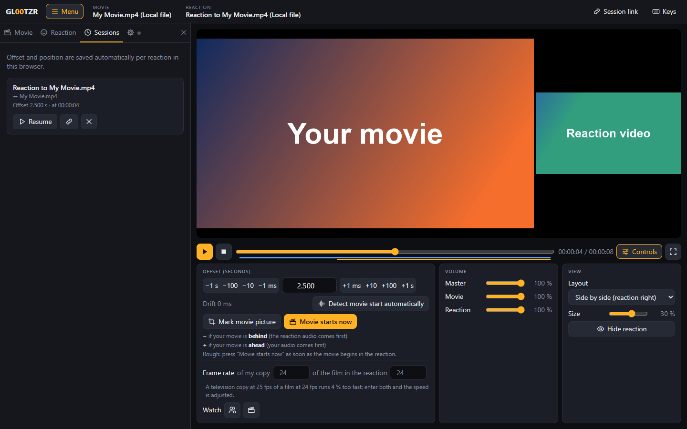

# GL00TZR

*Spectatorem spectantem specta* – watch the watcher watching.

Watch reaction videos in sync with your own movie or series. The reaction sets the pace, and the movie follows it with an adjustable, millisecond-accurate offset.

**▶ Try it right now: [onkeliroh.github.io/Glotz3r](https://onkeliroh.github.io/Glotz3r/)** – nothing to download or install. (The hosted page is served via https, so it only reaches a Jellyfin server that is available via https as well; for an http-only Jellyfin use the [executable](#download).)



The whole application is a static web page in [web/](web) ([index.html](web/index.html) with its [style.css](web/style.css) and scripts in [web/js/](web/js)). A small executable serves it locally and opens it in the browser.

## Build and run

### Download

Ready-made executables for Windows, Linux and macOS are attached to each [release](https://github.com/Onkeliroh/Glotz3r/releases), together with `glotz3r-web.zip` (the page alone, for hosting on any web server) and `checksums.txt`.

### As an executable

You need [Go](https://go.dev/dl/). Build:

```bash
go build -ldflags "-s -w" -o glotz3r.exe .
```

Then start `glotz3r.exe` with a double click. The page opens in the browser at `http://127.0.0.1:8097`. Closing the console window stops GL00TZR.

`web/` is embedded into the executable at build time, so rebuild after changing the page. If the old version is still running during the build, it is left behind as `glotz3r.exe~` and can be deleted once it is closed.

For other systems (Git Bash syntax; in PowerShell set `$env:CGO_ENABLED = "0"`, `$env:GOOS = "linux"` and `$env:GOARCH = "amd64"` first):

```bash
CGO_ENABLED=0 GOOS=linux GOARCH=amd64 go build -ldflags "-s -w" -o glotz3r .
```

```bash
CGO_ENABLED=0 GOOS=darwin GOARCH=arm64 go build -ldflags "-s -w" -o glotz3r .
```

Start options:

| Option | Effect |
|---|---|
| `-jellyfin https://…` | Presets the Jellyfin address; the address field in the page is hidden. The environment variable `JELLYFIN_URL` does the same. |
| `-port 1234` | Different port (default 8097, or the environment variable `PORT`). |
| `-no-browser` | Starts without opening the browser. |

### Without building, straight from source

```bash
go run .
```

### Without the Go server

The Go executable is not a requirement. It only exists because I was too lazy to deploy the page on another server. GL00TZR is a static page, so **any web server** (nginx or similar) can serve the contents of `web/` instead. Installing it as an app works there too. Only `config.json` normally comes from the Go server; it is optional, and a file with `{"jellyfin": "https://…"}` presets the Jellyfin address.

Opening `web/index.html` directly from disk does not work: the scripts are ES modules, which browsers only load via http/https. For development without Go, any static server does, for example `npx serve web` or `python -m http.server -d web`.

## Usage

1. Open the **Menu** on the left and, if you use Jellyfin, sign in to Jellyfin on the settings tab (gear icon) with your password or Quick Connect.
2. Choose one source each on the **Movie** and **Reaction** tabs. The header shows what is loaded.
3. Play the reaction. As soon as the person in the video starts their movie, press **Movie starts now** (key `R`). This sets the offset.
   Or let GL00TZR find it: **Detect movie start automatically** (key `A`). Put the progress bar a little before the point where the movie starts (anywhere in the video, e.g. for the second episode), then press it. It looks about six minutes of the reaction ahead of the bar and shows the progress in percent; with a small picture it usually needs one to two minutes after the movie has started in the reaction. For a reaction file, GL00TZR plays both videos muted at double speed and looks for the movie's picture in the reaction's picture (small, blurred or with a watermark is fine, a very small or heavily covered picture is not found) and sets the offset to within a few frames. If nothing is found with enough certainty, it says so; set the offset by hand then.
   For a new reaction file GL00TZR asks where the movie is in the reaction: move to a moment where its picture is visible and drag a frame around it (button **Mark movie picture** to do it later or again). The frame is remembered per reaction, and the detection then only looks there, which also finds small, dark, blurred or heavily covered pictures. It compares how the picture changes (cuts, fades, movement), so a fixed overlay such as “sync your copy now” or a timecode does not matter. It does not have to be exact (about 15 % too large, too small or shifted is fine), but a frame that is clearly off is not found. The offset is the one that fits the movie's content, even if your copy has a different intro (logos) than the reaction's. If your copy runs faster or slower than the reaction's (typically 4 % for a television copy at 25 instead of 24 pictures per second), GL00TZR says so and sets the **frame rates** of your copy and of the film in the reaction (25 and 24 fps), so that the movie stays in sync for the whole movie. They can also be entered by hand under the offset, and are saved per session like the offset (Jellyfin does not change them: direct play and transcoding keep the copy's own speed). **Search the whole picture** skips it.
   Once the offset is known, the reaction is paused and you choose: **From the beginning of the reaction** (what is said before the movie is worth hearing; the movie joins on time at its offset) or **Skip to the movie start** (a few seconds before the movie starts). Both are also available as buttons under the offset.
   A YouTube reaction gives no access to its pictures. There it listens to the sound instead (the original sound of the movie has to be audible in the reaction), which needs a Chromium browser that asks to share this tab with its audio.
4. Fine-tune the offset if needed: **−** if your movie is behind, **+** if it is ahead.

The browser remembers whether the panel is open, which tab is selected and whether the controls below the video are collapsed (**Controls** button).

### Sources

| Source | Movie | Reaction |
|---|---|---|
| Jellyfin (tree of libraries, series, seasons and episodes; or search by title, id or link to the details page) | yes | yes |
| YouTube link | no | yes |
| Local video file (file picker or drag & drop onto the video area) | yes | yes |

If the browser cannot play a Jellyfin file itself, the Jellyfin server transcodes it. “Current” then shows “transcoded by server”.

### Keys

| Key | Effect |
|---|---|
| Space | Play / pause |
| `,` `.` | Offset −/+ 10 ms |
| `-` `+` | Offset −/+ 100 ms |
| `R` | Movie starts now (reset offset) |
| `L` | Next layout |
| `V` | Hide / show the reaction picture, audio keeps playing |
| `F` | Fullscreen on / off |
| `H` or `?` | Keyboard shortcuts overview |

The keyboard's media keys (play/pause, stop) work as well.

### Sessions

Offset, frame rates and position are saved automatically per reaction in the browser and applied the next time the same reaction is loaded. **Session link** copies a session as a link, for example for another device. The link contains the sources (Jellyfin ids plus the address of the Jellyfin server, YouTube video), offset and position, but no credentials. Whoever opens it signs in with their own Jellyfin account; the session then loads by itself. Local files cannot be linked – the link only carries the file name, and you have to pick the file yourself. In the same browser (Chrome/Edge) a saved session reopens local files by itself after you picked them once with the file dialog or drag & drop – the browser never reveals the path, but remembers the file; it may ask once for permission. Elsewhere you pick the file again.

### Language

English and German, switchable on the settings tab (gear icon) of the menu; the default is the browser language. Another language only needs an entry in `LANGS` and a dictionary in `I18N` (both in `web/js/i18n.js`; the key is the English text). Missing translations are reported in the browser console.

### Color scheme

The settings tab offers color schemes; the choice is saved in the browser. The default is *Warm Sunset Journey for Cinematic Road Trips*. The others are *Ethereal Pastel Cinematic Dreamscape Palette*, *Cinematic Time Travel: A Colorful Journey*, *Cinematic Glamour with Gold Shimmer* and *Classic*, which is close to the earlier look. Each scheme is five colors, and every color of the interface is derived from them. The schemes come from the cinematic palettes at <https://colorany.com/color-palettes/cinematic-color-palettes/>.

To add one, add an entry to `SCHEMES` in `web/js/schemes.js`. List its five colors in role order, not in the palette's order:

1. **accent**: buttons, focus, the movie in the layout sketches and on the seek bar
2. **reaction**: the reaction in the layout sketches and on the seek bar
3. **highlight**: hover on the main buttons, the signed-in dot
4. **alert**: errors
5. **base**: the color that tints the backgrounds. Only its hue and part of its saturation are used; the backgrounds always stay dark, so a pastel or pure black works too

The accent and the reaction colors should be easy to tell apart. The accent should be light, because the text on it is dark.

## Install as an app (no need to start the server)

GL00TZR can be installed as an app (PWA). It then starts like a program of its own from the start menu, even when the `.exe` is not running:

1. Start the `.exe` once and open the page in Chrome or Edge.
2. In the menu under settings (gear icon) press **Install as app**, or use the install icon in the address bar.

The app runs at the same address (`http://127.0.0.1:8097`), so login and sessions are kept. The browser keeps the page cached. After changing files in `web/`, start the `.exe` once and open the app; it then fetches the new version. Firefox cannot install apps, but after the first visit it also opens the page at that address without the server.

## Good to know

- **Storage:** Login, sessions and settings live in the browser and apply per address. `http://127.0.0.1:8097` and `http://localhost:8097` are two separate stores for the browser, and so is a different port.
- **YouTube:** some videos do not allow embedding.
- **Pauses in the reaction video:** If the person in the video pauses their movie, the offset shifts and has to be readjusted by hand.

## Releasing

A release is built and published by GitHub Actions ([release.yml](.github/workflows/release.yml)) as soon as a version tag is pushed:

```bash
git tag v1.0.0
```

```bash
git push origin v1.0.0
```

The same workflow then publishes `web/` on GitHub Pages, so the page is also available at `https://onkeliroh.github.io/Glotz3r/` without downloading anything. This needs **Settings → Pages → Source: GitHub Actions** to be set once in the repository. The hosted page is served via https, so it only reaches a Jellyfin server that is itself available via https; with an http-only Jellyfin use the executable.

The workflow builds the executables for Windows, Linux and macOS, packs `web/` into `glotz3r-web.zip`, writes `checksums.txt` (SHA-256) and creates a GitHub release named after the tag with automatically generated release notes. The tag has to start with `v`. It is also written into the page as the version shown on the settings tab; a build from source shows `dev`. The macOS executables are not signed, so macOS warns on first start.

## Project layout

| File | Purpose |
|---|---|
| `web/index.html` | The page's markup; loads the style sheet, `js/schemes.js` and the entry module `js/main.js` |
| `web/style.css` | All styles; the colors come from the scheme variables at the top |
| `web/js/schemes.js` | Color schemes, applied before the page is drawn (a classic script in `<head>`, so no colors flash) |
| `web/js/main.js` | Entry module: runs each module's `start()` in a fixed order |
| `web/js/base.js` | Basics: element lookup, version (stamped by the release), storage, messages |
| `web/js/i18n.js`, `look.js` | Translations; scheme picker and layout sketches |
| `web/js/youtube.js`, `sync.js` | YouTube player adapter; keeping the movie in sync with the reaction |
| `web/js/detect.js`, `picture.js` | Automatic detection of the movie start; marking the movie's picture in the reaction |
| `web/js/sources.js`, `link.js`, `panel.js` | Loading sources, sessions; session links; menu panel state |
| `web/js/jellyfin.js`, `app.js` | Jellyfin sign-in, playback and picker; language buttons, app install, update notice and start |

The scripts are ES modules: each file names what it imports and exports. The modules import each other in cycles (for example, `sync.js` and `sources.js` call each other), so the order in which the browser evaluates them is not fixed. Hence two rules:

- **Load time only defines.** At module level there are only imports, functions and variables. Anything that touches the page (event handlers, the first display) goes into the module's `export function start()`, which `main.js` calls in order. Only the leaf modules `base.js` and `i18n.js` import nothing from the others, so they may run code at load time.
- **Imports are read-only.** A module cannot assign to a variable it imports. Shared state that other modules change has a small writer function in its home module (`setMaster`, `unmark`, `setPicRect`, `takePending`, …).
| `web/sw.js`, `web/manifest.webmanifest`, `web/icon-*.png` | Make the page installable as an app; `sw.js` keeps it in the browser cache |
| `docs/screenshot.png` | Screenshot for this README |
| `main.go`, `go.mod` | Small local server that serves the embedded files from `web/` |
| `.github/workflows/release.yml` | Builds the executables, publishes a GitHub release and deploys `web/` to GitHub Pages when a `v*` tag is pushed |
| `.claude/launch.json` | Preview configuration for Claude Code |
